<p align="center">
  
</p>

```bash
root@beluga:~$ cat about.txt
name      : BELUGA
from      : Tunisia 🇹🇳  →  living in Japan 🇯🇵
role      : bug bounty hunter · security researcher · full-stack developer
off-duty  : ⚽ soccer · anime figure collector - video games
```

### 🎯 What I hunt for

- **Web application security**: access control (IDOR), injection, XSS, SSRF, auth and session flaws
- **API security**: REST and GraphQL, broken object-level authorization, rate limits
- **Recon and automation**: mapping attack surface, scripting the boring parts

> I only test assets that are in scope of an authorized program, and I report what I find responsibly.

### 🧰 Toolbox

**Security**

      

**Building**

      

### 🚀 Currently building

**NihonCV**: most jobs in Japan ask for a 履歴書, the official Japanese resume format. NihonCV gives foreigners that exact layout, with the interface in 日本語 · English · Tiếng Việt · 简体中文 · 한국어. *Launching soon.*

---

<p align="center"><sub>🐋 the white whale of bug bounty · ⚽ · フィギュア collector</sub></p>
